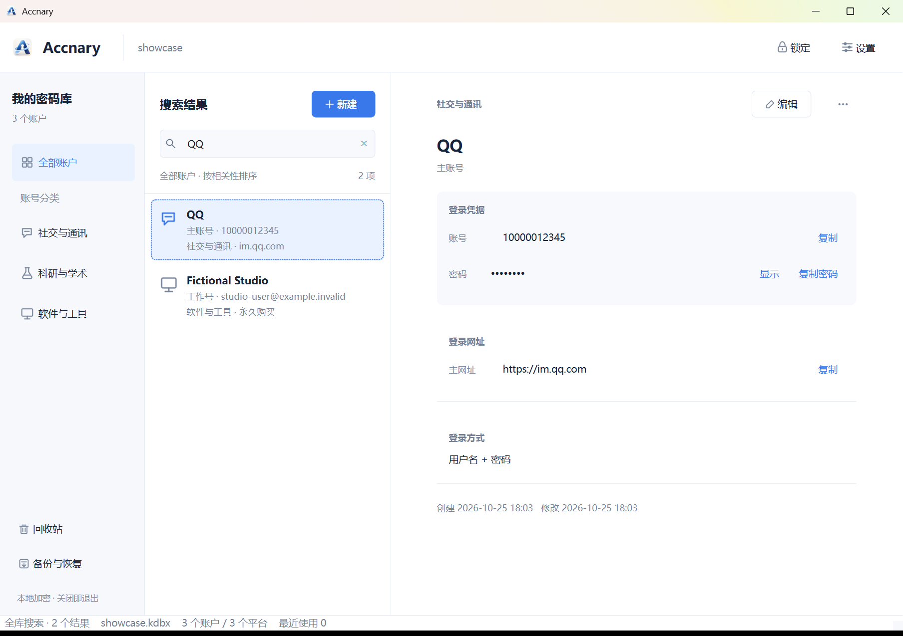
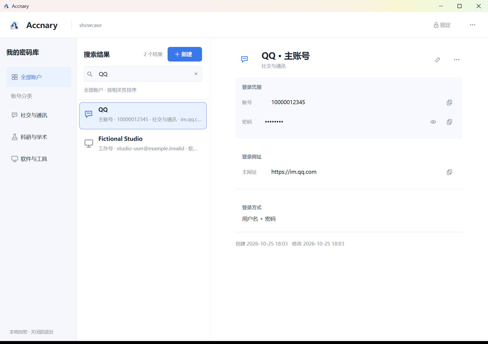
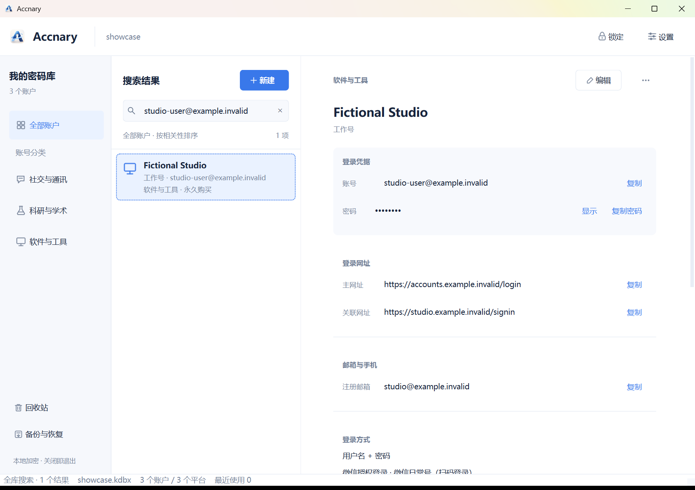
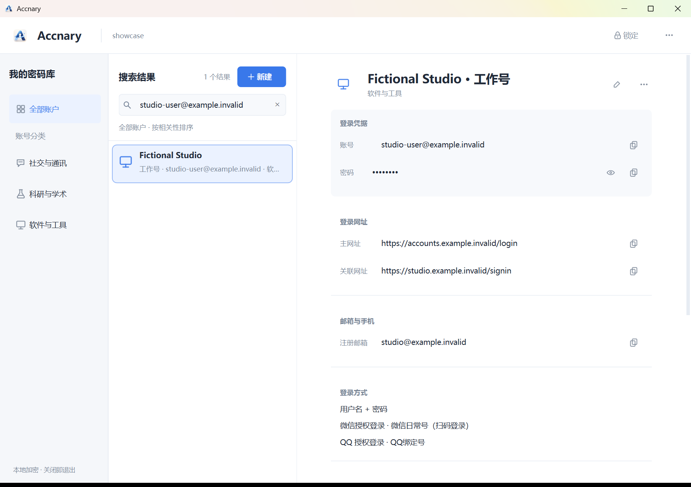
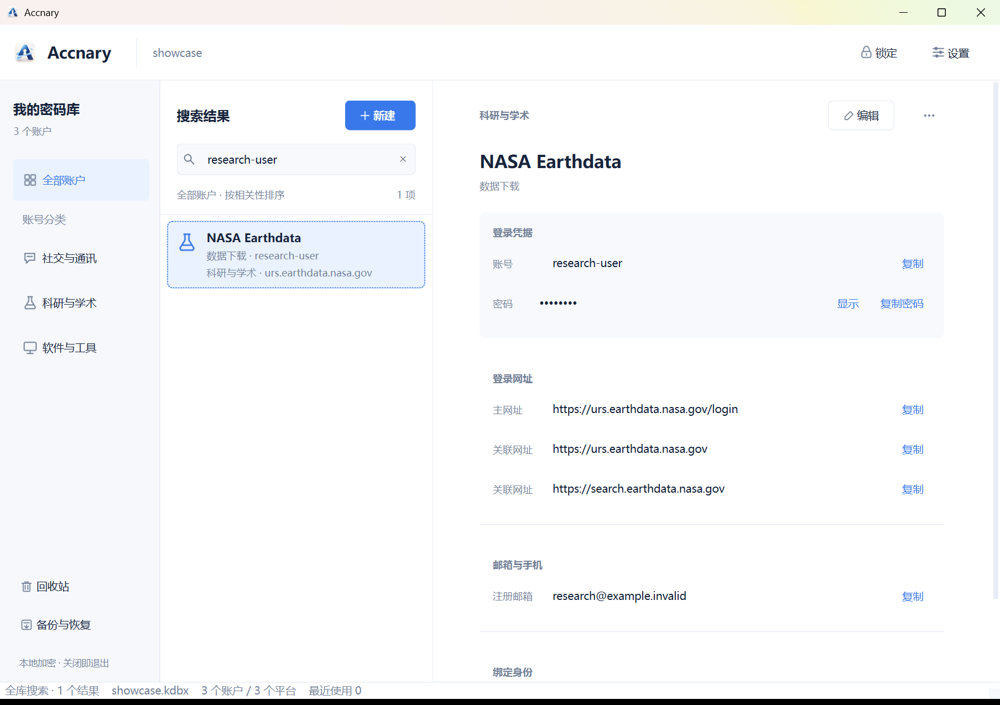
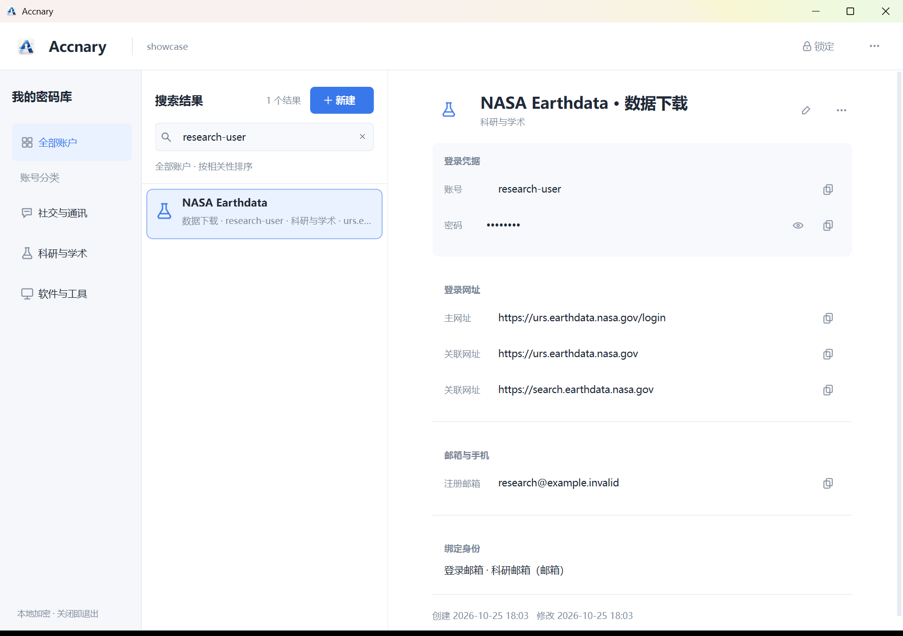

# Accnary 主窗口重设计验收

日期：2026-10-25

## 范围

本轮只重做主窗口，不改密码库加密/保存逻辑、数据模型或 KDBX Schema；未动账户编辑、设置、解锁等其他对话框。QQ、微信按用户账号记录展示，不做第三方身份验证。本轮也未增加恢复密码或第二主密码。

## 设计调整

- 取消传统工具栏和底部状态栏；顶部集中显示 Accnary、当前库、锁定和更多操作。
- 将新建按钮放到账户列表标题旁；备份、回收站、设置收入更多菜单。
- 左侧分类采用轻导航行，列表和详情成为连续工作区；小窗口可收起导航。
- 账户列表统一类别线性图标、标题、辅助信息及柔和选中态；焦点状态改为低对比实线环。
- 详情采用统一标题操作区；凭据字段统一对齐；凭据卡片突出显示，其他信息按内容分组，空分组隐藏。
- 详情阅读列居中，宽屏上限约 560 px 内容宽度，并随较窄窗口缩减；长网址不再被过窄列强制拆成多行。
- 浅色与深色主题沿用同一布局；收藏相关 UI 不显示，旧数据字段仍保留。

## 同一虚构数据的改前/改后截图

测试库只包含虚构记录（QQ、Fictional Studio、NASA Earthdata），截图未展示密码明文。`before-*` 来自原版 release，`after-*` 来自本轮源码启动。

| 场景 | 改前 | 改后 |
|---|---|---|
| QQ 简单账号 |  |  |
| 多登录方式付费软件账号 |  |  |
| 科研平台账号 |  |  |

其他验收截图：

- [深色主题](after-dark-qq.png)
- [100% 缩放](after-dpi-100.png)
- [125% 缩放](after-dpi-125.png)
- [900 × 620 小窗口](after-small.png)

缩放通过进程级 Qt 比例验证，未修改 Windows 显示设置。主窗口实际请求尺寸分别为 1220 × 850、1525 × 1063、1830 × 1275；小窗口为 900 × 620。

## 桌面交互验收

使用临时目录内的虚构 KDBX 库，通过 UI Automation 控件和键盘完成：

- 解锁测试库并显示 QQ、复杂付费软件、科研平台记录。
- 搜索 `urs.earthdata.nasa.gov/log` 网址片段并定位 NASA Earthdata。
- 手动锁定后确认旧账户详情文本已从窗口隐藏，再重新解锁。
- 检查浅色、深色、100%/125%/150% 缩放和 900 × 620 窗口下的布局、换行及滚动。

未使用真实凭据，未控制鼠标或修改系统设置。临时测试目录已清理。截图是源码版本，不代表打包版验收。

## 自动化回归

最终全量 pytest：201 passed in 557.21s（退出码 0）。运行命令：`python -m pytest -q -o addopts= -p no:cacheprovider`。

另运行 17 项 UI 定向测试并通过，覆盖工作区结构、详情区、主题、剪贴板及响应式详情宽度。

## 发布产物

本轮未构建 EXE，`release\Accnary.exe` 未覆盖。当前文件大小为 46,089,365 bytes，SHA-256：`AD8A714D1FB38968BF7D0846460CC8EDD8BA9EB637A892620646C8C4527BE643`。界面更新目前只在源码中。

## 后续边界

先请用户审阅本轮主窗口截图；本轮没有推广改动到新增/编辑、设置或解锁窗口，也没有启动发布流程。